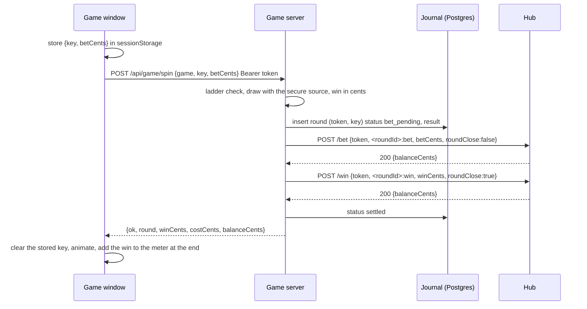
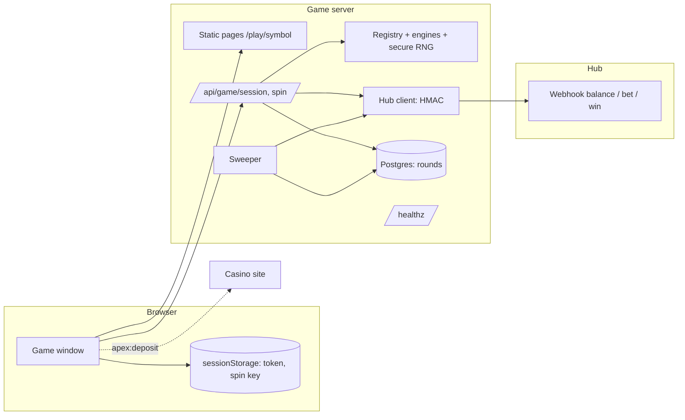

# Flow overview — the game window and the game server (own slots)

Scope: the player's browser with the game window, the game server (`slots-server`: HTTP application, round journal in Postgres, sweeper) and the game hub's webhook (`Casino-Game-Aggregator`). Drawn upward from the browser; it meets the origin's downward tree (`from-origin/flow-overview.md`) at the contract. Observable behavior only; the order of work is in `plan.md` and `tasks.md`.

| Actor | Role |
|---|---|
| Player | Opens a game, presses SPIN, presses DEPOSIT |
| Game window | The patched Z1000k client: shows rounds, keeps the token and the key of an unfinished spin, decides nothing |
| Game server | Serves the pages, draws and saves every round, calls the hub, keeps the journal, retries |
| Hub | Session by token, wallet calls; the origin's half |
| Casino site | Hosts the frame, listens for `apex:deposit` (the lobby half) |

## Flow 1 — Opening a game

```
Player → site → hub LaunchCasino(<identity>, e.g. apexslots_tropic_escape) → address {playUrl}/play/{symbol}?token&lang&lobby   (lang and lobby are ignored by the window)
Browser → GET /play/{symbol}                 (static page of the game, headers: frame-ancestors, no-referrer)
  └─ game window: read token → sessionStorage
       └─ unfinished spin key in sessionStorage?  yes → Flow 5 (resume)   no → continue
       └─ GET /api/game/session   Authorization: Bearer <token>
            └─ server → hub POST /webhook/{partner}/balance {token}      (signed)
                 ├─ 200 → {balanceCents}                 → meter shows the balance (S2)
                 ├─ 422 SESSION_NOT_FOUND                → session_expired (S7)
                 └─ 401 / 403 / 404 / no answer          → unavailable (S11)
```

The token stays in the address, so a reload of the frame opens the game again. Without a token the window shows S7 and sends nothing.

## Flow 2 — A spin that wins



The outcome is drawn and saved before the bet, but it leaves the server only after the hub accepted the bet. A round with no win ends after the bet call, sent with `roundClose: true`; there is no win call.

## Flow 3 — A spin the balance cannot pay

```
POST /api/game/spin
  └─ draw, insert round (bet_pending)
       └─ hub /bet → 422 INSUFFICIENT_FUNDS
            ├─ round → refused, result deleted, never repeated
            └─ ← {ok:false, error: insufficient_funds, balanceCents}
Game window: NOT ENOUGH FUNDS + DEPOSIT (S6)
  └─ DEPOSIT pressed → window.parent.postMessage({type:'apex:deposit'}, '*') → the site checks event.source and event.origin and opens its deposit page
```

Other final refusals of the bet (`LIMIT_EXCEEDED`, `REFUSED`, `CONFLICT`, `BAD_REQUEST`) end the round the same way and answer `bet_refused`. `SESSION_NOT_FOUND` ends it `refused` and answers `session_expired`. A bet answered 401, 403 or 404 (a configuration fault on the hub's side, nothing moved) ends it `refused` and answers `unavailable`; the window clears its key. The one exception: when an earlier attempt of that bet ended with an unknown outcome (`INTERNAL`, a timeout, a transport error) the bet may already be debited, so the round stays `bet_pending`, the call is repeated with the same transaction id until a definite answer with `bet_pending_alert`, and the browser gets `busy`. Before it refuses a spin on its own shown balance, the window asks `GET /api/game/session` for the current balance. A repeated key returns the same refusal; a new SPIN is a new key and a new round id.

## Flow 4 — A leg that gets no answer

```
POST /api/game/spin
  └─ bet: BUSY | INTERNAL | no answer
       ├─ the hub queues a second call of the same wallet for up to 8 s and then answers BUSY; our call timeout and bet budget are 10 s, so BUSY arrives as "nothing moved"
       ├─ a BUSY with budget left is repeated (same transaction id) every 0.2 s growing to 1 s; an attempt is cut to the remaining budget
       ├─ still no definite answer → ← {ok:false, error: busy}   the window keeps the key, shows the stored bet and locks the bet controls (S9), sends the key again on the next SPIN
       └─ sweeper: claims the round with a lease (SWEEP_LEASE_MS, longer than a call; the request moves the due time before each of its calls, and a repeated key takes the same lease and waits for the holder's outcome), calls outside any transaction, writes the result only if the status is still the claimed one;
            repeats /bet (same transaction id) at 5 s doubling to 1 h until answered; after the 5th failure: error log bet_pending_alert per attempt
            └─ accepted → /win if the win is above zero → settled      (the player's repeat of the key returns the round)
  └─ bet accepted, win: BUSY | INTERNAL | no answer | any refusal except CONFLICT, BAD_REQUEST
       ├─ ← {ok:true, round, creditPending:true}       outcome shown, win marked BEING CREDITED (S5)
       └─ sweeper: repeats /win with the same transaction id and the round's own token, growing pauses
            ├─ accepted → settled
            ├─ after the 5th failure: error log win_pending_alert per attempt
            └─ CONFLICT | BAD_REQUEST → parked for an operator
```

Nothing in the hub completes an unconfirmed leg by itself; only this repeat does. The round id never changes, so the hub's idempotency by transaction id answers the first result if an earlier attempt had gone through.

## Flow 5 — A lost connection and a resumed spin

```
Window: spin sent, all three attempts fail → S8, key and bet stay in sessionStorage
  ├─ SPIN pressed again, or the frame reloaded (Flow 1) → POST /api/game/spin with the stored key and bet
  │     ├─ the round exists (settled, win_pending, refused) → its first answer, no second draw, no second charge
  │     └─ no round yet → a normal spin (Flow 2)
  └─ tab closed → the key is gone; a round the hub had accepted is still completed by the sweeper and the win reaches the balance, unseen
```

## Summary map



## Out of scope

- Demo and guest play, a rollback or void of a debited bet, anything about Pragmatic (origin).
- Deployment: subdomain, certificate, sizing, container image, a pager on `win_pending_alert`.
- What the casino site does with `apex:deposit` (the lobby half).
- The one-off re-check of each game's RTP with its own `npm run sim:exact`.
