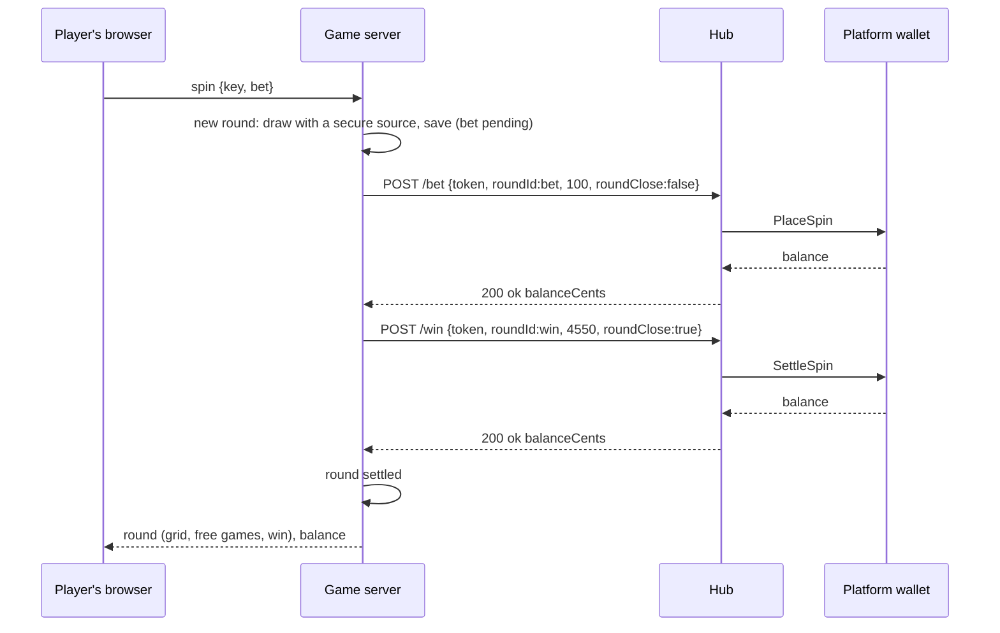
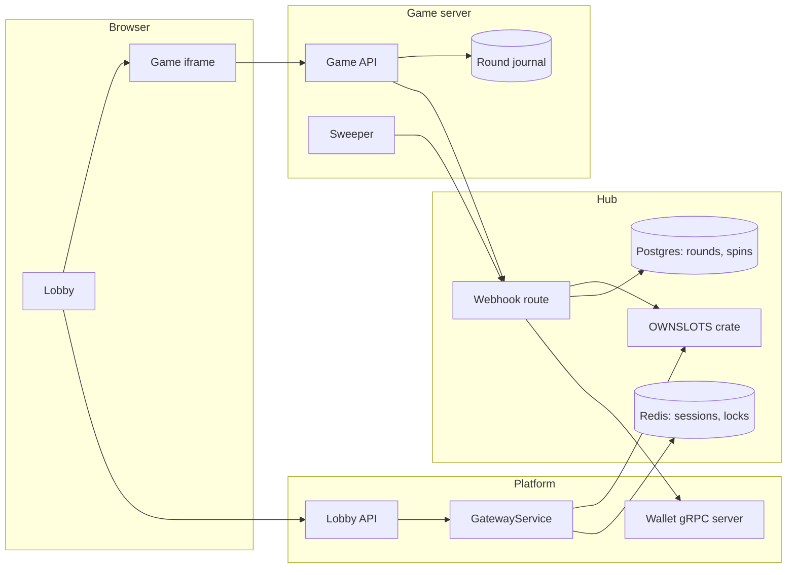

# Flow overview — own slots as a vendor of the hub

Scope: the player's browser, the platform (lobby and wallet), the game hub, and the game server with its round journal. Observable behavior only; the order of work is in `plan.md` and `tasks.md`.

| Actor | Role |
|---|---|
| Player | Opens the lobby, a game, spins |
| Platform | Lists games from the hub, opens the game window, holds the balance in its wallet |
| Hub | Catalog, launch URL, session token, money calls, wallet calls |
| Game server | Serves the game page, decides and saves every round, asks the hub to move money |

## Flow 1 — The lobby shows the twelve slots

```
Operator tool: insert partners row OWNSLOTS (secretKey, playUrl)   (SQL, once)
  └─ sync (weekly, or PARTNER=<identity>)
       ├─ OwnslotsPartner::catalog          → the twelve games, provider APEXSLOTS
       ├─ casino_providers / casino_games / casino_partner_game_connects   (written)
       └─ casino_provider_connects          (route per operator)
Game server script: UpdateImage × 12        → tile images under relative paths
Player → platform lobby → GatewayService.ListCasino → twelve tiles in the place of "Original"
```

A provider with no route is invisible to the operator; the sync creates the route, so a row inserted without a sync shows nothing. Disabling a game, the route or the partner hides it at the next list.

## Flow 2 — Opening a game

```
Player → platform /casino/play/<symbol> → GatewayService.LaunchCasino
  └─ hub: session saved in Redis (token, operator, partner, game, player, USD)
       └─ OwnslotsPartner::launch → <playUrl>/play/<symbol>?token=…&lang=…&lobby=…
Platform: url → iframe      Game page loads from the game server
Game page → game server: session → hub /webhook/<partner>/balance {token} → balance
```

No demo: `LaunchCasinoDemo` answers "unsupported" and the platform shows no demo switch for these games. A player with a zero balance is stopped by the platform before launch, as for every game.

## Flow 3 — A spin with a win



The outcome is drawn and saved before the bet call, but it reaches the browser only after the bet is debited. A spin without a win ends at the bet call, which carries `roundClose: true`. The platform sends its header balance update after each of the two wallet legs.

## Flow 4 — A spin the balance cannot pay

```
Browser → game server: spin
  └─ game server: round drawn and saved (bet pending)
       └─ hub /bet → PlaceSpin refused (insufficient funds)
            ← 422 {refused, INSUFFICIENT_FUNDS}
  └─ round marked refused, outcome never sent
Game window: "not enough funds" + button → message to the platform → deposit page
```

A refused bet is final for its round: the hub keeps the refused leg unconfirmed, so repeating the same bet call after a deposit would debit it. The game server stores the refusal against the spin key and answers a repeated key with that refusal; a new key draws a new round with a new round id and is tested against the balance again.

## Flow 5 — A win that cannot be credited at once

```
game server: /bet accepted, round "win pending"
  ├─ /win → 503 retry (BUSY or INTERNAL) or no answer
  ├─ response to the browser: outcome shown, win marked "being credited"
  └─ background sweeper: repeats /win with the same transactionId and the round's own token, with growing pauses, until 200;
       a refusal other than CONFLICT or BAD_REQUEST does not stop it (an alert is raised), those two are parked for an operator
       └─ the hub's idempotency answers the first result if the first attempt had gone through
```

Nothing in the hub completes an unconfirmed bet or win leg on its own; only the vendor's repeat does, so the repeat is the game server's job.

## Summary map



## Out of scope

- Demo and guest play.
- A rollback or void of a debited bet.
- Anything about Pragmatic.
- How the game server sizes and deploys on its subdomain.
- What happens to a player idle for more than 24 hours: the hub answers `SESSION_NOT_FOUND`, the game window tells the player to reopen the game.
